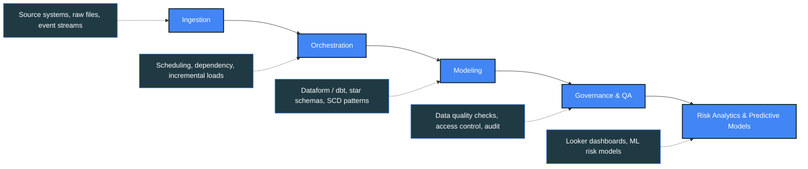

# Ketro Sithole

**Cloud Data Engineer** | Data & Risk Analytics
BSc Computer Science, University of Pretoria

  
  
  
  
  

I build data pipelines and platforms that support risk analytics and predictive modeling, with a background that also covers software engineering and data science. 4+ years of experience working across the full data lifecycle: ingestion, orchestration, modeling, and the governance that keeps it all trustworthy.

<b>Quick facts</b>

 

| | |
|---|---|
| Currently | Building incremental models and SCD patterns on BigQuery |
| Learning | Snowflake, streaming architectures |
| Teaching | Data Analytics and Data Engineering mentorship |
| Recognition | 7x Hackathon Winner, Top 15 SA Young Geek (2023) |
| Ask me about | Dataform, dbt, medallion architecture, legacy-to-cloud migration |

---

## How data moves through what I build

---

## Focus areas

<b>Data Engineering</b> <i>(primary)</i>

 
Building and maintaining reliable pipelines, batch and incremental, on cloud data warehouses, with an emphasis on data quality, observability, and scale.

<b>Data Science & Predictive Modeling</b>

 
Applying statistical methods and ML to turn historical data into forward-looking risk models.

<b>Software Engineering</b>

 
Backend systems and services that the data platforms run on.

<b>IT Risk & Governance</b>

 
Making data systems auditable and controlled, not just functional.

---

## Tech stack

**Languages**

  
  
  
  

**Platforms & tools**

  
  
  
  
  
  
  
  
  

---

## GitHub stats

  
  

  

  

  

---

## Contact

- LinkedIn: [linkedin.com/in/ketro-sithole](https://www.linkedin.com/in/ketro-sithole-76b8b1165/)
- GitHub: [github.com/KetroSithole](https://github.com/KetroSithole)
